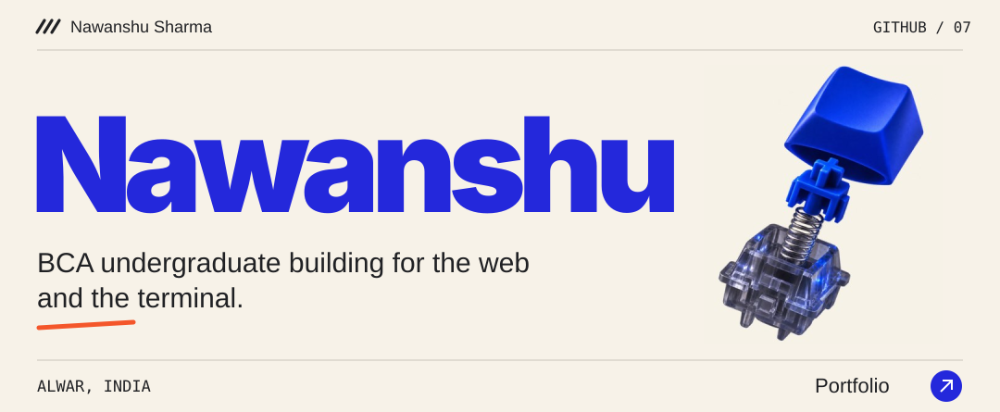
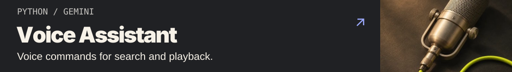
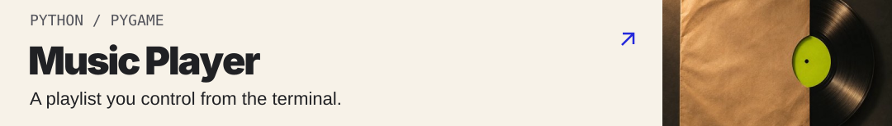

<a href="https://nawanshu.dpdns.org">
  <picture>
    <source media="(max-width: 700px)" srcset="https://raw.githubusercontent.com/Nawanshu07/Nawanshu07/main/assets/cover-mobile.svg">
    
  </picture>
</a>

## Selected work

<a href="https://github.com/Nawanshu07/Chat-system">
  <picture>
    <source media="(max-width: 700px)" srcset="https://raw.githubusercontent.com/Nawanshu07/Nawanshu07/main/assets/smalltalk-mobile.svg">
    
  </picture>
</a>

<a href="https://github.com/Nawanshu07/Voice-Assistant">
  <picture>
    <source media="(max-width: 700px)" srcset="https://raw.githubusercontent.com/Nawanshu07/Nawanshu07/main/assets/voice-mobile.svg">
    
  </picture>
</a>

<a href="https://github.com/Nawanshu07/Music-Player">
  <picture>
    <source media="(max-width: 700px)" srcset="https://raw.githubusercontent.com/Nawanshu07/Nawanshu07/main/assets/music-mobile.svg">
    
  </picture>
</a>

[More projects ↗](https://nawanshu.dpdns.org/work)　·　[About me](https://nawanshu.dpdns.org/about)　·　[Get in touch](https://nawanshu.dpdns.org/contact)
