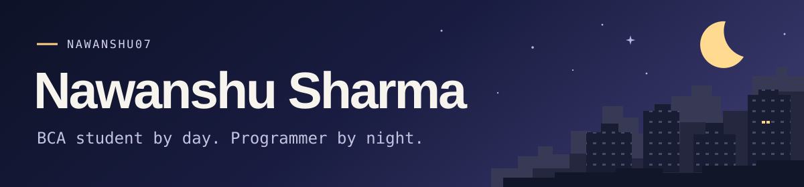

I’m learning full-stack development one project at a time. In Smalltalk, I’ve been figuring out how messages travel between browsers. In Python, I build tools for the everyday stuff, like finding the same file hiding under two different names.

[Visit my portfolio ↗](https://nawanshu.dpdns.org)

## Selected projects

**[Smalltalk](https://github.com/Nawanshu07/Chat-system)** · React, Express, Socket.IO  
A private chat app. Messages arrive in real time, and the conversation is still there when you sign back in.

**[File Forge](https://github.com/Nawanshu07/File-Forge)** · Python, Rich  
A terminal tool for cleaning up messy folders. It finds duplicate files by comparing their contents, even when their names differ.

**[Voice Assistant](https://github.com/Nawanshu07/Voice-Assistant)** · Python, Gemini  
A voice-controlled assistant that can play music and automate everyday tasks.

## After hours

I work through [algorithm problems](https://github.com/Nawanshu07/Leet-Code), read novels, and watch anime. Most of my coding happens after midnight.
